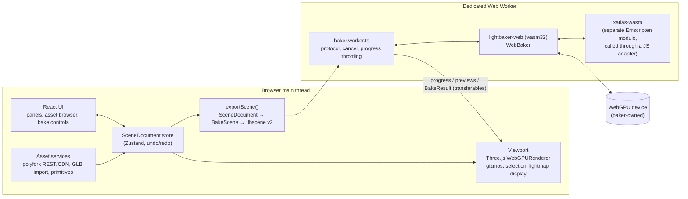
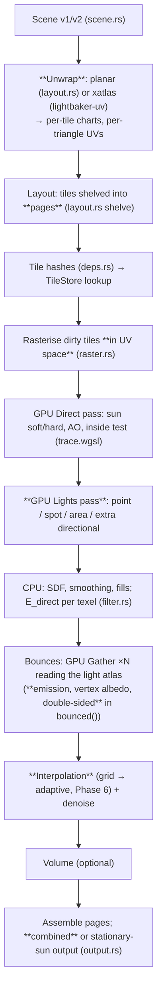

# Architecture

Target architecture after Phase 5. Decisions are recorded in [adr/](adr/); interfaces in
[INTERFACES.md](INTERFACES.md); lighting semantics in [LIGHTING_MODEL.md](LIGHTING_MODEL.md).

## 1. System overview



Key properties:

- The **engine** (`lightbaker`, `lightbaker-uv`) is platform-agnostic Rust; it builds natively (CLI,
  tests) and for `wasm32-unknown-unknown`.
- The **bridge** (`lightbaker-web`) is the only crate that knows about JS/wasm-bindgen.
- The **app** never sees GI internals: it sends a `BakeScene` + `BakeConfig` and receives lightmap
  pages + UVs (INTERFACES.md).
- Baking runs in a **worker with its own GPU device** (ADR-0002); Three.js renders on the main
  thread.

## 2. Repository layout

```
.
├── AGENTS.md, README.md, ROADMAP.md, LICENSE, THIRD_PARTY_NOTICES.md
├── Cargo.toml                      workspace (upstream + new crates)
├── crates/
│   ├── lightbaker/                 upstream core (ADR-0001), features: native | web
│   │   └── src/{bake,bvh,cache,deps,encode,filter,layout,output,raster,scene,volume}.rs
│   │       src/gpu/{mod.rs,trace.wgsl}
│   │       + src/platform/{time,par}.rs, src/store.rs, src/lights.rs   (new)
│   ├── lightbaker-cli/             upstream native CLI
│   ├── lightbaker-uv/              Unwrapper contract + native xatlas FFI (ADR-0006); vendor/xatlas @ f700c77
│   └── lightbaker-web/             wasm-bindgen bridge → pkg/ (generated, not committed)
├── js/                             upstream TS package (scene v2 writer, bake reader, three helper)
├── app/                            Vite + React + Three.js editor
│   ├── src/bake/                   worker, protocol client, exportScene, applyLightmaps
│   ├── src/viewport/               imperative Three.js viewport (ADR-0007)
│   ├── src/state/                  SceneDocument store, commands, persistence
│   ├── src/ui/                     React panels
│   ├── src/assets/                 polyfork client, GLB import, primitives
│   └── e2e/                        Playwright
├── test-scenes/                    deterministic scenes + expect.json
├── docs/                           this documentation, ADRs, PROJECT_BRIEF.md
└── openspec/                       OpenSpec specs and changes
```

## 3. Engine (`crates/lightbaker`)

### 3.1 Bake pipeline (target)

Upstream stages are kept in order; **bold** marks new or changed stages.



### 3.2 Platform layer (ADR-0003)

| Concern | `native` | `web` |
|---|---|---|
| GPU init | `Gpu::new()` (block_on) or `Gpu::open().await` | `Gpu::open().await`, `Backends::BROWSER_WEBGPU` |
| Readback | `map_async` + `poll(wait)` + await | `map_async` + await |
| Time | `web_time::Instant` (= std) | `web_time::Instant` (performance.now) |
| Parallel iterators | rayon | sequential |
| Tile store | `FsStore` (zstd files, upstream naming) | `MemoryStore` (+ IndexedDB via JS) |
| KTX2 supercompression | zstd | none (scheme 0) |

### 3.3 GPU data layout (after Phases 3–4)

| Binding | Type | Content |
|---|---|---|
| 0 `nodes` | storage, read | BVH nodes, 32 B (unchanged) |
| 1 `tris` | storage, read | 80 B: `v0+material`, `e1+flags (double-sided, emissive)`, `e2`, `uv01`, `uv2+page+albedo` |
| 2 `materials` | storage, read | per material: `albedo+opacity`, `emission+flags` |
| 3 `params` | uniform | upstream `Params` + light count, page sizes |
| 4 `texels` | storage, read | 64 B texel records (unchanged), bound per batch |
| 5 `out` | storage, read_write | per-item results |
| 6 `lights` | uniform (≤ 64 KiB) | light records, 64 B each (replaces `charts`) |
| 7 `light` | storage, read | irradiance atlas, page-major (later: `rgba16float` texture array) |

Rust `#[repr(C)]` structs and WGSL structs are kept identical and covered by layout tests.

Status (P3.3): `tris` is 80 B with `uv01`/`uv2` (page written as 0; `e1.w` flags and `uv2.w` albedo
reserved) and `bounced()` interpolates the hit's UV; binding 6 (`charts`) is removed and free for
`lights` (P4.1). Layout test: `crates/lightbaker/tests/layout.rs` (naga reflection of `trace.wgsl`).

### 3.4 Incremental baking

Two meanings, both supported:

1. **Reuse** (upstream): a tile whose dependency hash is unchanged is taken from the `TileStore`.
   With object tiles (ADR-0004), moving one object rebakes only tiles within reach. Lights are in
   the global hash at first (any light edit rebakes everything; Preview quality makes this fast).
2. **Progressive**: results are reported per batch/tile; the worker sends throttled partial
   previews so the viewport fills in while baking.

### 3.5 Cancellation, errors, device loss

- `Options.cancel()` checked after each awaited GPU batch and between CPU stages.
- Errors are typed (`BakerError`, INTERFACES.md §7); `anyhow` errors map to `internal` with
  context; validation errors (`invalid-scene`, `limit-exceeded`) are raised **before** GPU work.
- wgpu device-lost callback → `device-lost`; the app recreates the worker.

### 3.6 Memory budget

Before allocating, the engine estimates CPU and GPU memory from atlas pages, covered texels and
triangles; if a limit (adapter limits, a wasm heap budget, e.g. 1.5 GiB) would be exceeded it
fails with `limit-exceeded` and a suggestion (lower texel density, smaller pages, fewer bounces).

## 4. UV unwrapping (`crates/lightbaker-uv`)

- `Unwrapper` trait; implementations: `Planar` (wraps upstream `layout.rs`), `Xatlas` (native:
  FFI over vendored xatlas; web: `xatlas-wasm` in the worker through a JS adapter imported by
  `lightbaker-web`, ADR-0006). Both xatlas paths use the same xatlas commit and options.
- Xatlas per **object tile**: `addMesh` (world-space positions, normals, indices, material ids so
  charts never span materials), `computeCharts`, `packCharts` (texels per unit, padding,
  `resolution = 0` for an auto-sized tile rectangle), output UVs + `xref` + index remap + chart ids.
- Results are cached by a hash of (geometry, transform scale, options): moving/rotating an object
  only re-shelves it.
- Original texture UVs (`uv`) are never touched; lightmap UVs go to `uv1`.

## 5. Bridge (`crates/lightbaker-web`)

- `wasm-bindgen` + `wasm-bindgen-futures`; `console_error_panic_hook`; built with `wasm-pack
  --target web` (or `wasm-bindgen-cli`) into `pkg/`.
- Accepts `.lbscene` v2 bytes + JSON config; returns results as JS objects holding typed arrays
  (zero-copy views copied once into transferables).
- Exposes `capabilities()` for the app's startup check (no device creation side effects).

## 6. Application (`app/`)

Phase 2 (P2.5) state: a single PoC page (`app/index.html`, `src/main.ts`) with the baker worker
(`src/bake/`: `protocol.ts`, `bakerCore.ts`, `baker.worker.ts`, `client.ts`) and an unlit Three.js
lightmap view (`src/view/lightmapView.ts`). The editor described below starts in Phase 5 and reuses
`src/bake/`.

- **Startup:** capability check in the worker → banner if WebGPU baking is unavailable (the editor
  still works for scene building and unbaked preview).
- **Document model:** `SceneDocument` (INTERFACES.md §2) in a Zustand store; all edits are
  commands (undo/redo); autosave to IndexedDB; import/export JSON.
- **Viewport:** reconciles Three.js objects from the store; `TransformControls`,
  `OrbitControls`, raycast selection, light helpers, view modes: *unbaked* (real-time Three.js
  lights), *baked* (LIGHTING_MODEL.md §8), *lightmap only*, *UV charts*, *validity*.
- **Bake service:** `exportScene()` → worker; progress UI (phase, %, elapsed, ETA from per-phase
  throughput); cancel; apply results (`uv1` + `lightMap` per mesh; geometry rebuilt when xatlas
  split vertices).
- **Asset browser:** polyfork search/preview/insert (ADR-0008), GLB import, primitives library.
- **Export:** GLB + lightmaps bundle (INTERFACES.md §10).

## 7. Build and deployment

- Rust workspace (native + wasm32), pnpm workspace (`js`, `app`, `crates/lightbaker-web/pkg`);
  `xatlas-wasm` is a pinned npm dependency of `app`.
- Vite dev server serves the worker as an ES module and both `.wasm` assets (ours and xatlas').
- Static hosting is sufficient (no server). COOP/COEP headers are **not** required (no wasm
  threads) — keep it that way unless an ADR introduces threads.
- CI: GitHub Actions on standard runners with software GPU adapters (ADR-0009).
- Details: [BUILD.md](BUILD.md).
